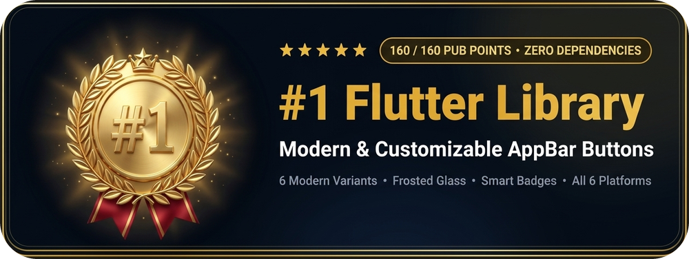
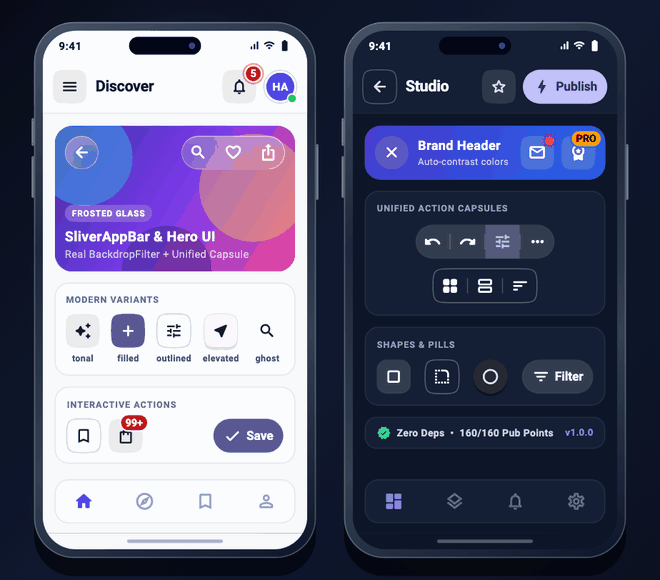
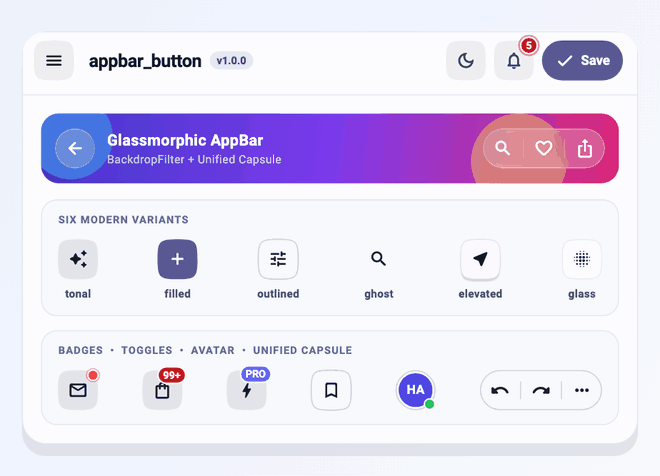

<p align="center">
  <a href="https://pub.dev/packages/appbar_button">
    
  </a>
</p>

# appbar_button

[](https://pub.dev/packages/appbar_button)
[](https://pub.dev/packages/appbar_button/score)
[](https://github.com/andikpbw/flutter-appbar-button/blob/main/LICENSE)
[](https://pub.dev/packages/appbar_button)

**Modern, lightweight, and customizable AppBar buttons for Flutter.**

Elevate your `AppBar`, `SliverAppBar`, `CupertinoNavigationBar`, and custom toolbars with zero third-party dependencies, automatic light/dark/colored contrast adaptation, frosted glassmorphism, notification badges, inline loading states, smooth toggle morphing, and unified segmented action capsules.

### Live Mobile UI Preview (Light & Dark Mode)

<p align="center">
  
</p>

### Interactive Variants & Live Theme Transition

<p align="center">
  
</p>

---

## Features

- **Zero External Dependencies** — Built purely on Flutter's core rendering and Material primitives; lightweight and 100% compatible with Android, iOS, Web, WASM, macOS, Windows, and Linux.
- **Six Modern Variants** — `tonal`, `filled`, `outlined`, `ghost`, `elevated`, and frosted `glass` (`BackdropFilter`).
- **Four Refined Shapes** — `rounded`, Apple-inspired continuous `squircle`, `circle`, and `stadium` capsule.
- **Ergonomic Named Constructors** — `AppBarButton.icon`, `.back`, `.close`, `.menu`, `.pill`, `.toggle`, and `.avatar` — all `const`-ready.
- **Smart Slot Sizing** — Never stretches awkwardly inside `AppBar.leading`'s tight `56×56` constraints.
- **Automatic Contrast Adaptation** — Reads ambient `IconTheme` & `ColorScheme` so buttons look crisp on light, dark, colored, and gradient app bars.
- **Rich Notification Badges** — `AppBarButtonBadge.dot`, `.count` (with `99+` overflow and auto-hide on zero), and `.label`, with optional animated `pulse` halo and cutout border.
- **Built-In Micro-Interactions** — Tactile press-scale animation, inline `isLoading` spinner (blocks double-taps without layout jitter), smooth `AnimatedSwitcher` toggle morphing, optional haptic feedback, and keyboard focus rings.
- **Unified Action Capsules** — Group trailing actions with `AppBarButtonGroup` or fuse them into a sleek segmented pill with `AppBarButtonGroup.unified`.
- **ThemeExtension Ready** — Configure global defaults once via `AppBarButtonThemeData` in `ThemeData.extensions` or override per subtree with `AppBarButtonTheme`.
- **Accessible & RTL Ready** — Full `Semantics`, localized tooltips, keyboard focus navigation, `MediaQuery.disableAnimationsOf` support, and automatic RTL mirroring.

---

## Installation

Add `appbar_button` to your `pubspec.yaml`:

```yaml
dependencies:
  appbar_button: ^1.0.0
```

Then run:

```bash
flutter pub get
```

---

## Quick Start

```dart
import 'package:appbar_button/appbar_button.dart';
import 'package:flutter/material.dart';

class HomeScreen extends StatefulWidget {
  const HomeScreen({super.key});

  @override
  State<HomeScreen> createState() => _HomeScreenState();
}

class _HomeScreenState extends State<HomeScreen> {
  bool _isSaving = false;
  bool _isBookmarked = false;

  @override
  Widget build(BuildContext context) {
    return Scaffold(
      appBar: AppBar(
        leading: const AppBarButton.back(),
        title: const Text('Dashboard'),
        actions: [
          AppBarButtonGroup(
            children: [
              AppBarButton.toggle(
                icon: Icons.bookmark_border_rounded,
                selectedIcon: Icons.bookmark_rounded,
                isSelected: _isBookmarked,
                tooltip: 'Bookmark',
                onPressed: () => setState(() => _isBookmarked = !_isBookmarked),
              ),
              AppBarButton.icon(
                Icons.notifications_none_rounded,
                badge: const AppBarButtonBadge.count(count: 5, pulse: true),
                tooltip: 'Notifications',
                onPressed: () {},
              ),
              AppBarButton.pill(
                icon: Icons.check_rounded,
                label: 'Save',
                variant: AppBarButtonVariant.filled,
                isLoading: _isSaving,
                onPressed: () => setState(() => _isSaving = !_isSaving),
              ),
            ],
          ),
        ],
      ),
      body: const SizedBox.shrink(),
    );
  }
}
```

---

## Usage Examples

### 1. Surface Variants & Shapes

```dart
AppBarButton.icon(
  Icons.auto_awesome_rounded,
  variant: AppBarButtonVariant.tonal,     // tonal, filled, outlined, ghost, elevated, glass
  shape: AppBarButtonShape.squircle,      // rounded, squircle, circle, stadium
  size: AppBarButtonSize.medium,          // small (34), medium (40), large (44)
  onPressed: () {},
)
```

### 2. Frosted Glass Hero AppBar & Unified Capsule

```dart
Row(
  children: [
    AppBarButton.back(
      variant: AppBarButtonVariant.glass,
      shape: AppBarButtonShape.circle,
    ),
    const Spacer(),
    AppBarButtonGroup.unified(
      padding: EdgeInsets.zero,
      variant: AppBarButtonVariant.glass,
      children: [
        AppBarButton.icon(Icons.search_rounded, onPressed: () {}),
        AppBarButton.icon(Icons.favorite_border_rounded, onPressed: () {}),
        AppBarButton.icon(Icons.ios_share_rounded, onPressed: () {}),
      ],
    ),
  ],
)
```

### 3. Badges (Dot, Count, Label & Pulse)

```dart
// Pulsing notification dot
AppBarButton.icon(
  Icons.mail_outline_rounded,
  badge: const AppBarButtonBadge.dot(
    color: Color(0xFFEF4444),
    pulse: true,
  ),
  onPressed: () {},
);

// Numeric counter (renders "99+" when count > maxCount; hides at 0 by default)
AppBarButton.icon(
  Icons.shopping_bag_outlined,
  badge: const AppBarButtonBadge.count(count: 142, maxCount: 99),
  onPressed: () {},
);

// Custom pill text badge
AppBarButton.icon(
  Icons.bolt_rounded,
  badge: const AppBarButtonBadge.label(
    label: 'PRO',
    color: Color(0xFF6366F1),
  ),
  onPressed: () {},
);
```

### 4. Profile Avatar Button

```dart
AppBarButton.avatar(
  avatar: const CircleAvatar(child: Text('HA')),
  badge: const AppBarButtonBadge.dot(
    color: Color(0xFF22C55E),
    alignment: AlignmentDirectional.bottomEnd,
    offset: Offset.zero,
  ),
  onPressed: () {},
)
```

### 5. Adaptive Navigation Buttons

```dart
// Automatically pops via Navigator.maybePop, selects iOS chevron on Apple platforms,
// and hides itself when the route cannot pop:
const AppBarButton.back(hideWhenCannotPop: true)

// Automatically pops modal routes:
const AppBarButton.close()

// Automatically opens Scaffold drawer (or endDrawer with isEndDrawer: true):
const AppBarButton.menu()
```

### 6. Global App-Wide Theming

Register `AppBarButtonThemeData` inside `ThemeData.extensions` to style every `AppBarButton` across your entire app consistently:

```dart
MaterialApp(
  theme: ThemeData(
    useMaterial3: true,
    colorSchemeSeed: const Color(0xFF4F46E5),
    extensions: const [
      AppBarButtonThemeData(
        style: AppBarButtonStyle(
          variant: AppBarButtonVariant.tonal,
          shape: AppBarButtonShape.squircle,
          size: AppBarButtonSize.medium,
          pressedScale: 0.92,
          hapticFeedback: AppBarButtonHaptic.light,
        ),
      ),
    ],
  ),
  home: const HomeScreen(),
)
```

---

## API Overview

| Class / Enum | Description |
| --- | --- |
| `AppBarButton` | Core button widget with `.icon`, `.back`, `.close`, `.menu`, `.pill`, `.toggle`, and `.avatar` constructors |
| `AppBarButtonVariant` | `tonal`, `filled`, `outlined`, `ghost`, `elevated`, `glass` |
| `AppBarButtonShape` | `rounded`, `squircle`, `circle`, `stadium` |
| `AppBarButtonSize` | `small` (34dp), `medium` (40dp), `large` (44dp) |
| `AppBarButtonStyle` | Complete immutable style object with `copyWith`, `merge`, and `lerp` |
| `AppBarButtonBadge` | `.dot`, `.count`, and `.label` badge overlay configuration with pulse support |
| `AppBarButtonGroup` | Spaced action group or `.unified` segmented capsule container |
| `AppBarButtonTheme` / `AppBarButtonThemeData` | `InheritedTheme` and `ThemeExtension` for global or scoped styling |
| `AppBarButtonHaptic` | `none`, `selection`, `light`, `medium`, `heavy` |

---

## Support

This open-source library is proudly supported by **[Humanize AI](https://humanize.id)**.

If you find `appbar_button` useful, please consider starring the [GitHub repository](https://github.com/andikpbw/flutter-appbar-button), filing issues or feature requests, and visiting [Humanize AI](https://humanize.id).

## License

Released under the [MIT License](https://github.com/andikpbw/flutter-appbar-button/blob/main/LICENSE).
